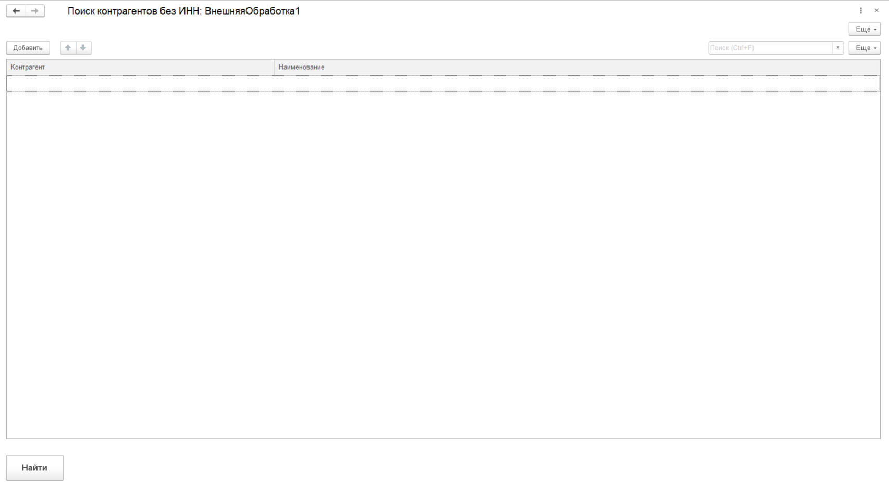
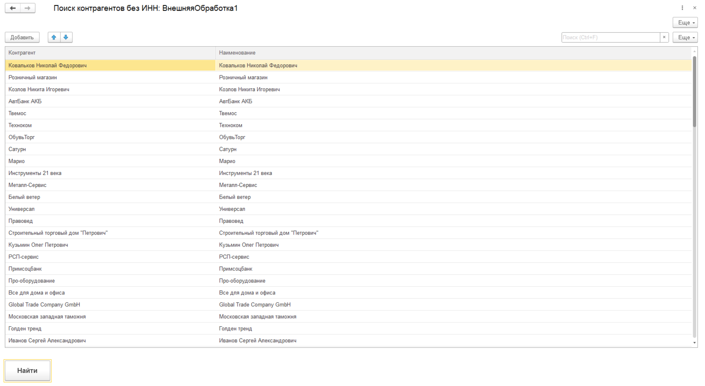
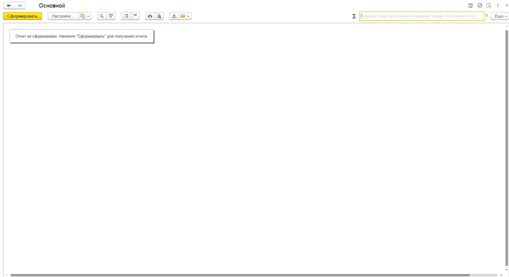
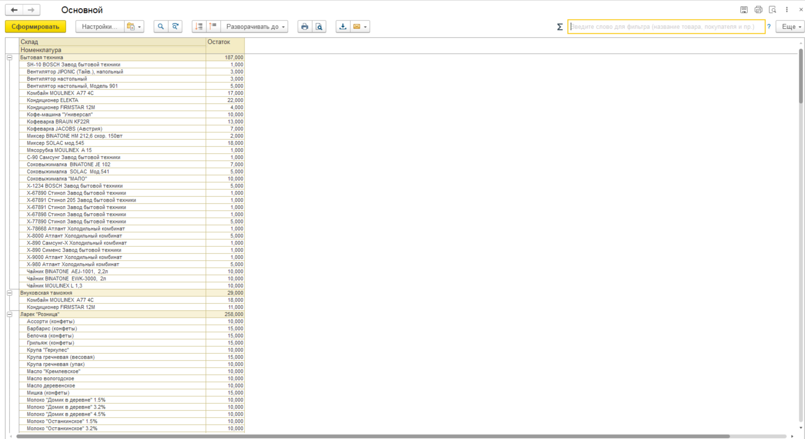
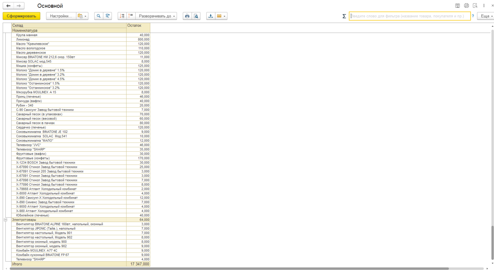
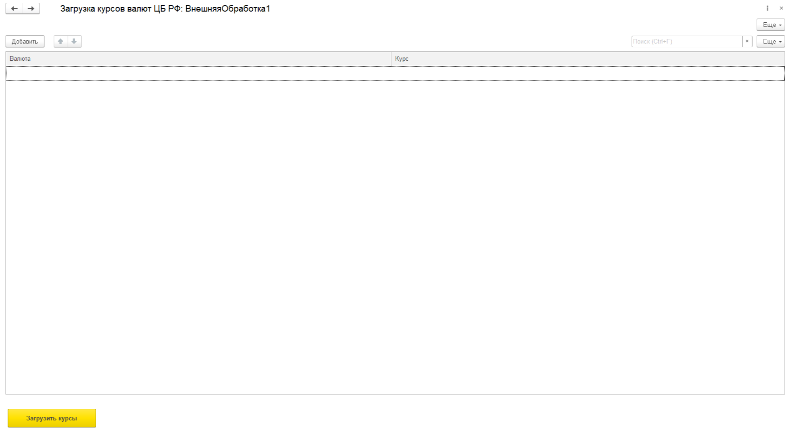
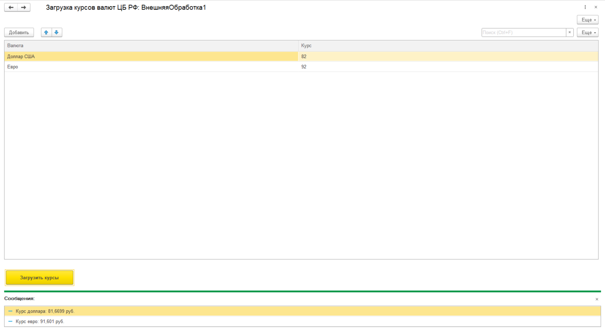

# Здравствуйте, меня зовут Квасов Даниил

Начинающий 1С-разработчик. Учусь в колледже по специальности «Банковское дело», параллельно прохожу расширенный курс «Разработчик 1С» от Нетологии и уже год самостоятельно практикуюсь в разработке на платформе «1С:Предприятие 8». Веду собственные проекты и выкладываю их сюда как примеры своей работы.

## Обо мне

- Студент колледжа, специальность «Банковское дело»
- Прохожу расширенный курс «Разработчик 1С» от Нетологии
- Программирую в 1С около года, учусь системно и на практике
- Работаю с документами, справочниками, регистрами, формами и отчётами
- Пишу запросы на языке 1С, делаю отчёты на СКД
- Осваиваю доработки типовых конфигураций через расширения (УТ, БП)
- Цель: вырасти в уверенного 1С-разработчика и работать над реальными задачами бизнеса

## Что я умею

**Платформа 1С:**
- Конфигурирование: справочники, документы, регистры сведений и накопления
- Написание кода на встроенном языке: процедуры, функции, циклы, условия
- Работа с формами: создание, элементы, обработчики событий
- Запросы на языке 1С: соединения, группировки, итоги
- Отчёты на СКД
- Расширения конфигураций: заимствование объектов, перехват методов (`&Вместо`, `&После`, `&Перед`)
- Внешние обработки и отчёты (.epf, .erf)

**Инструменты:**
- Git и GitHub: коммиты, ветки, оформление репозиториев
- 1С:Конфигуратор, 1С:Предприятие (учебная версия)

## Мои проекты

Здесь я выкладываю свои доработки для типовых конфигураций. Каждый проект — в отдельной папке со своим README, скриншотами и инструкцией по подключению.

| Проект | Что делает | Конфигурация |
|---|---|---|
| [Обработка "Поиск контрагентов без ИНН"](./01-Обработка-ПоискКонтрагентов) | Ищет контрагентов с пустым ИНН и выводит их в таблицу | УТ 11 || УТ 11.5 |
| [Отчет "Остатки товаров на складах"](./02-Отчет-ОстаткиТоваров) | Отчет на СКД с группировкой по складам и возможностью выбора даты | УТ 11 | 
| [Обработка "Загрузка курсов валют"](./03-Обработка-ЗагрузкаКурсов) | Интеграция с API ЦБ РФ через HTTP-запросы и парсинг JSON | 1С, HTTP, JSON |
| [Обработка "Загрузка погоды" (Open-Meteo)](./04-Обработка-ЗагрузкаПогоды) | Интеграция с API Open-Meteo. Передача параметров в URL, разбор вложенного JSON | 1С, HTTP, JSON |

*Примечание: готовые файлы расширений (`.cfe`, `.erf`) прикреплены к релизам проектов — их можно скачать и подключить к демо-базе.*

## Как я оформляю проекты

Чтобы мои работы было удобно проверять, каждый проект содержит:
- `README.md` с описанием, скриншотами и инструкцией по подключению
- папку `src/` с исходниками в XML (удобно смотреть diff на GitHub)
- осмысленную историю коммитов — видно, как шла разработка
- готовый файл для скачивания в разделе «Releases»

## Сейчас изучаю

- Углублённая работа с СКД и сложными отчётами
- Интеграции 1С с внешними системами (HTTP-сервисы, обмен данными)
- Производительность запросов и оптимизация
- Материалы расширенного курса «Разработчик 1С» от Нетологии

## Скриншоты проектов

  
<b>Посмотреть скриншоты работ (нажмите, чтобы развернуть)</b>

  **1. Поиск контрагентов без ИНН**
  
  
  
  **2. Отчет Остатски товаров (СКД)**
  
  
  

  **3. Загрузка курсов валют (API + JSON)**
  
  

  **4. Загрузка актуальной погоды в Москве (API + JSON)**
  
  
 

## Контакты

- Email: kvasov.daniils@yandex.ru (резервная: dkguardian@yandex.ru)
- Telegram: @kvsdnll
- Локация: РФ, Жуковский, Московская область

